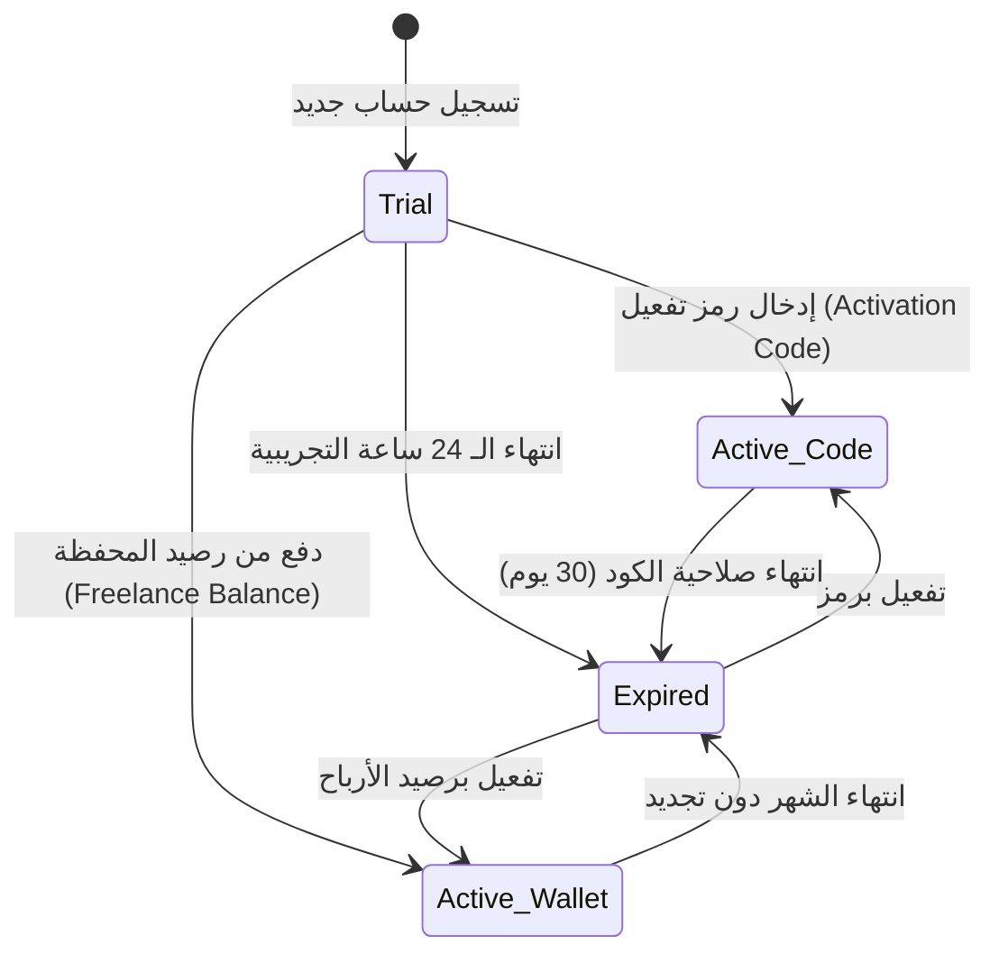

# دليل استوديو أدوات الذكاء الاصطناعي وإدارة الاشتراكات
## Render Group Studio & RenderLancer Integration Guide

---

### 1. الهدف الاستراتيجي
دمج منظومة أدوات الإبداع الرقمي **Render Group Studio** داخل منصة **RenderLancer** لحل أكبر عقبة تواجه الكفاءات المستقلة في فلسطين، وهي عدم القدرة على دفع اشتراكات المنصات العالمية (Runway, Midjourney, Kling, ChatGPT Plus) بسبب العقوبات، إغلاق البوابات، أو التكاليف المرتفعة.

توفر المنصة ترسانة من **12 أداة ذكاء اصطناعي رائدة** يمكن التحكم بها، تجربتها، وتفعيل اشتراكاتها من شاشة موحدة وبطرق دفع محلية أو من أرباح المشاريع مباشرة.

---

### 2. تفاصيل الأدوات الـ 12 المتاحة في الاستوديو

| الأداة (Tool) | التصنيف | الوصف الفني وقدرات الأداة |
| :--- | :--- | :--- |
| **1. ريندر شات (Render Chat)** | المساعد والمحادثة | مساعد ذكي شامل للإجابة على الأسئلة البرمجية والتصميمية، تحليل الصور والملفات، والبحث اللحظي في الإنترنت بدقة متناهية. |
| **2. GPT Image 2** | الصور والتصميم | توليد وتعديل الصور الفنية والتجارية مع دعم الصور المرجعية المتعددة (Multi-Reference) لإنشاء شخصيات متطابقة وهوية ثابتة. |
| **3. تعديل نانو بنانا برو (Nano Banana Pro)** | الصور والتصميم | تعديل ومعالجة وتحسين جودة الصور بسرعة فائقة ودقة تصل إلى 4K Ultra HD وتفريغ الخلفيات وإزالة العناصر غير المرغوبة. |
| **4. Seedance 2.0** | الفيديو والسينما | نظام التوليد السينمائي المتطور لمحاكاة فيزياء الحركة الواقعية المدعوم بتقنية ByteDance و Kling v5 Omni. |
| **5. Veo 3.1** | الفيديو والسينما | تحويل الصور والنصوص إلى لقطات فيديو سينمائية متحركة بدقة إخراج واقعية وزوايا كاميرا ديناميكية. |
| **6. انتقال فريمين (Omni Transition)** | الفيديو والسينما | رفع فريم البداية وفريم النهاية لإنشاء انتقال بصري سينمائي ناعم ومبهر مع توليد مؤثرات صوتية تلقائية مطابقة للحركة. |
| **7. محرك الحركة (Motion Master)** | الفيديو والسينما | توجيه مسارات الحركة وتحريك العناصر بدقة في الإعلانات والمشاهد المتحركة. |
| **8. استوديو التصوير (Virtual Studio)** | التصوير والمشاهد | إعداد جلسات تصوير افتراضية للمنتجات والأشخاص بإضاءات وخلفيات واقعية جاهزة للتجارة الإلكترونية. |
| **9. تبديل الوجوه / الأشخاص (Face Swap)** | الهوية والأشخاص | تبديل ملامح الوجه أو الشخص بالكامل في الصور ومقاطع الفيديو بدقة متناهية وبضغطة واحدة. |
| **10. القياس الافتراضي (Virtual Try-on)** | التجارة والأزياء | تجربة الملابس والأزياء افتراضياً على الصور الشخصية أو صور العارضين بدقة بالغة تفيد متاجر الملابس والمصممين. |
| **11. استخراج البرومبت (Prompt Extractor)** | الهندسة العكسية | رفع أي صورة واستخراج الوصف الدقيق (البرومبت) والباراميترات المستخدمة في إنشائها لإعادة توليد أعمال مماثلة. |
| **12. أفتار الذكاء الاصطناعي (AI Avatar)** | الفيديو والمحتوى | تحويل الصور الثابتة إلى أفتار بشري ناطق بأي لغة مع مزامنة دقيقة لحركة الشفاه وتعبيرات الوجه لتسجيل الفيديوهات والدروس. |

---

### 3. آلية التفعيل وإدارة الاشتراكات (Subscription Lifecycle)

#### 1. الفترة التجريبية المجانية (24-Hour Free Trial)
* بمجرد إنشاء الحساب، يُمنح المستخدم فترة تجريبية مجانية لمدة 24 ساعة لكافة الأدوات.
* يظهر عداد تنازلي حي في الهيدر واللوحة الجانبية: `الفترة التجريبية تنتهي خلال: 23 ساعة و 51 دقيقة`.

#### 2. نظام رموز التفعيل (Activation Codes Engine)
* أكواد مسبقة الدفع يولدها المشرف من لوحة الإدارة (`Admin Dashboard`).
* مثال: `RENDER-GOLD-7X9Q` يمنح وصولاً شاملاً لمدة 30 يوماً.
* يمكن توزيع الأكواد عبر شركاء المنصة، الجامعات، أو بيعها عبر وكلاء محليين في غزة والضفة بوسائل دفع نقدية أو محافظ محلية.

#### 3. الدفع الذاتي من أرباح العمل الحر (Freelance Wallet Pay)
* عندما ينجز المستقل مشروعاً على **RenderLancer** ويحصل على مستحقاته، يمكنه تفعيل باقة الاستوديو مباشرة بخصم المبلغ من محفظته الرقمية.
* لا يتطلب هذا وجود أي بطاقة فيزا أو ماستركارد دولية، مما يمنح المستقل استقلالية مالية كاملة.
