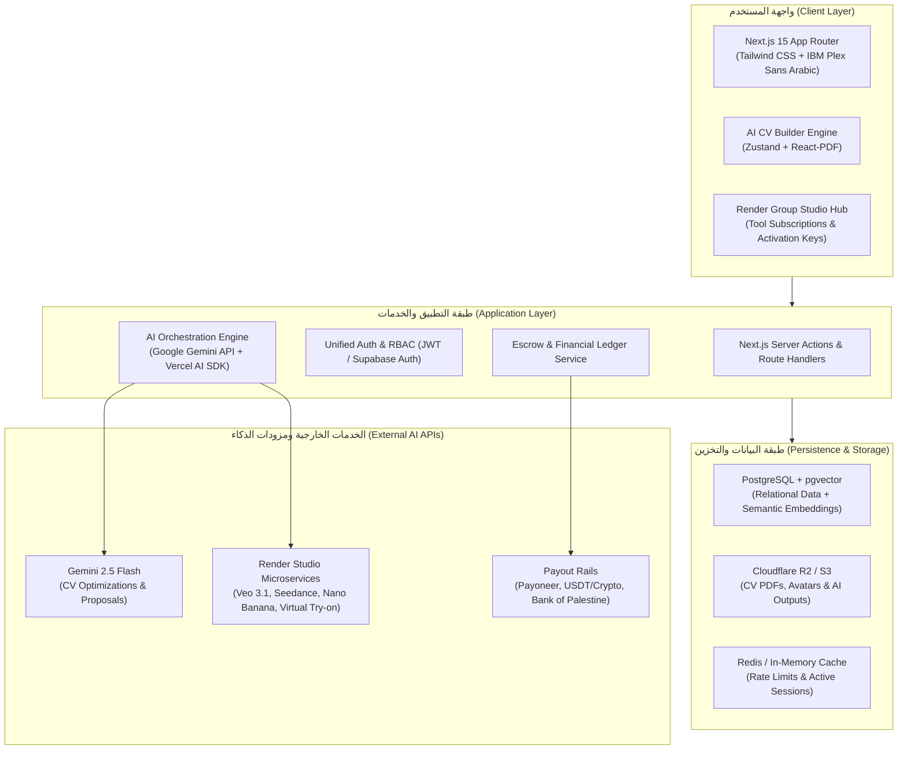
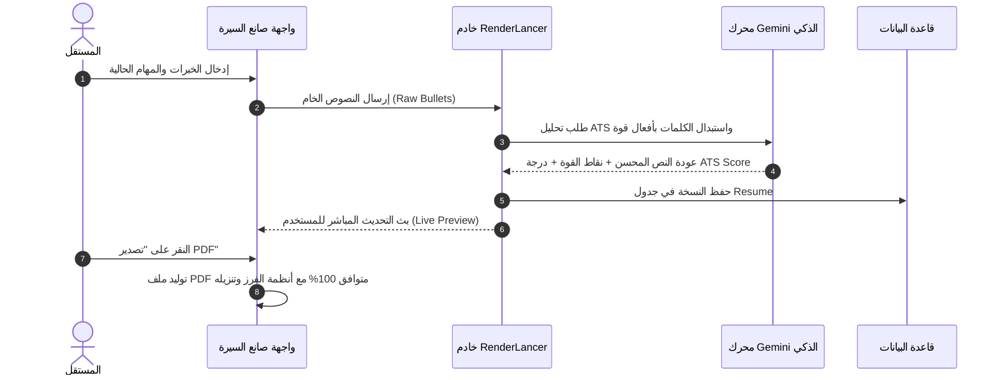
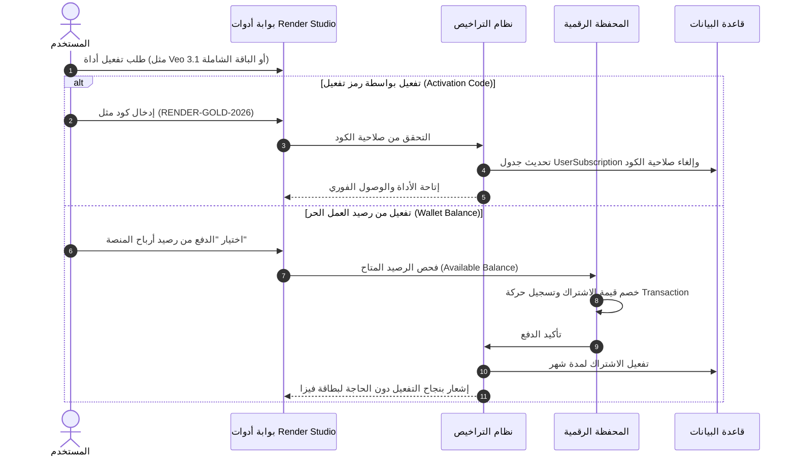

# التوثيق المعماري للنظام (System Architecture Specification)
## منصة RenderLancer & Render Group Studio

---

### 1. الرؤية الهندسية (Architectural Vision)
تتبنى منصة **RenderLancer** معمارية حديثة قائمة على أسلوب **Full-Stack Modular Monolith** المعتمد على **Next.js 15 (App Router)**، مع الاتصال المباشر بخدمات الذكاء الاصطناعي (AI Orchestration Layer) وقواعد بيانات PostgreSQL المدعومة بالمتجهات (Vector DB).

تتيح هذه المعمارية تلبية متطلبات السرعة، والأداء اللحظي (Streaming)، والدعم الكامل لاتجاه الكتابة العربي (RTL First)، مع تكامل آمن وسلس بين سوق العمل الحر واستوديو أدوات الذكاء الاصطناعي التابع لـ **Render Group**.

---

### 2. تدفقات البيانات والعمليات الأساسية (Core Data Flows)

#### التدفق 1: صانع السيرة الذاتية الذكي وفاحص الـ ATS (AI CV Flow)

#### التدفق 2: تفعيل وإدارة اشتراكات أدوات الذكاء الاصطناعي (AI Studio Subscription Flow)

#### التدفق 3: مطابقة المشاريع بالذكاء الاصطناعي (AI Job Matcher Flow)
1. يقوم صاحب العمل بنشر وظيفة أو مشروع جديد.
2. يقوم النظام بتوليد متجهات رياضية دلالية (Vector Embedding) لوصف المشروع ومتطلباته وتخزينه في `Job.jobEmbedding`.
3. بمجرد فتح المستقل للمنصة، يقوم استعلام `pgvector` بحساب مسافة جيب التمام (Cosine Distance):
   $$\text{Match \%} = (1 - \text{cosine\_distance}(\text{profileEmbedding}, \text{jobEmbedding})) \times 100$$
4. تُرتب الوظائف أمام المستقل حسب نسبة التوافق الأكثر دقة (مثلاً: 96% تطابق مع مهاراتك وخبراتك السابقة).

---

### 3. الأمان، التوثيق وصلاحيات النظام (Security & RBAC)

* **التوثيق الموحد (Single Sign-On - SSO):** حساب واحد مشفر باستخدام Argon2id / Bcrypt، مع استخدام جلسات JWT آمنة ومحمية بـ `HttpOnly Cookies`.
* **عزل الصلاحيات (Row-Level Security - RLS):**
  * لا يستطيع أي مستخدم الوصول لبيانات السيرة الذاتية أو المحفظة المالية لمستخدم آخر.
  * المشرفون فقط من يملكون صلاحيات إصدار أكواد التفعيل وتعديل الأسعار وإدارة الكورسات في لوحة الإشراف.
* **حماية التوليد بالذكاء الاصطناعي (Rate Limiting & Anti-Abuse):**
  * حدود يومية للعمليات التجريبية في الاستوديو.
  * مراقبة واستهلاك محدد في جدول `AIToolUsageLog` لمنع هجمات الاستنزاف.
