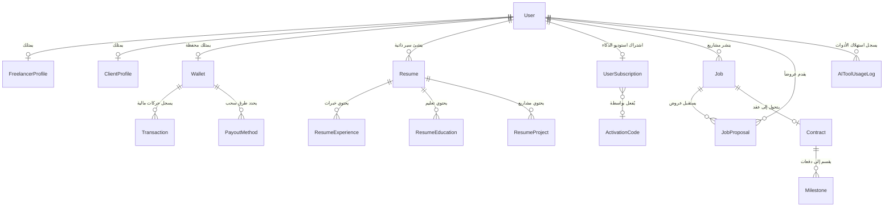

# توثيق قاعدة البيانات والهندسة العلائقية (Database Schema Architecture)
## منصة RenderLancer & Render Group Studio

---

### 1. نظرة عامة (Overview)
تم تصميم قاعدة البيانات باستخدام محرك **PostgreSQL** المتقدم مع امتداد **`pgvector`** للبحث الدلالي والذكاء الاصطناعي، وباستخدام **Prisma ORM** لإدارة النماذج والعلاقات بأمان نوعي كامل (Type-Safety).

تغطي قاعدة البيانات 7 نطاقات وظيفية رئيسية (Core Domains):
1. **نظام الهوية الموحد (SSO & Identity)**
2. **الملفات الشخصية للمستقلين والعملاء (Profiles & Skills)**
3. **صانع السير الذاتية الذكي (AI CV & Resume Studio)**
4. **سوق العمل والمشاريع (Marketplace, Jobs & Proposals)**
5. **التعاقدات وحماية الضمان المالي (Contracts & Escrow)**
6. **محرك اشتراكات أدوات الذكاء الاصطناعي (Render Group Studio AI Engine)**
7. **المحفظة الرقمية وحلول الدفع الفلسطينية (Wallet & Payout Rails)**

---

### 2. مخطط العلاقات الكيان (Entity Relationship Diagram - ERD)



---

### 3. تفاصيل الجداول والنطاقات (Tables Breakdown)

#### النطاق 1: الهوية والمستخدمين (Identity & Authentication)
* **جدول `User`**:
  * يحوي الحساب الموحد للوصول لـ RenderLancer و Render Studio.
  * يدعم الأدوار: `FREELANCER` (مستقل)، `CLIENT` (صاحب عمل)، `DIASPORA_PARTNER` (شريك من الشتات)، و `ADMIN`.
  * حقول التوثيق الفلسطيني: `verificationStatus` للتحقق من هوية المواهب الفلسطينية المعتمدة.

#### النطاق 2: صانع السير الذاتية الذكي (AI CV Studio)
* **جدول `Resume`**:
  * يحوي بيانات السيرة، الهدف المهني، الملخص المحسن بالـ AI، والقالب المختار (`EXECUTIVE_GOLD`, `TECH_MINIMALIST`...).
  * حقل `atsScore` (درجة التوافق مع أنظمة الفرز من 100).
  * حقل `atsFeedback` (مصفوفة JSON تحوي نصائح وتحسينات الذكاء الاصطناعي).
* **جدول `ResumeExperience`**:
  * يحوي الخبرات، ومفصول إلى `bulletsRaw` (ما كتبه المستخدم) و `bulletsAIEnhanced` (الصياغة القوية المولدة بالـ AI بأفعال الإنجاز والأرقام).

#### النطاق 3: استوديو أدوات الذكاء الاصطناعي (Render Group Studio AI Engine)
* **جدول `AITool`**:
  * يسجل الأدوات الـ 12 المتاحة: `veo-3-1`, `seedance-2-0`, `gpt-image-2`, `nano-banana-pro`, `render-chat`, `virtual-try-on`, `ai-avatar`, `face-swap`, `prompt-extractor`, `motion-master`, `photo-studio`, `omni-transition`.
* **جدول `UserSubscription`**:
  * يدير اشتراك المستخدم (الفترة التجريبية `FREE_TRIAL_24H` مع حقل `trialExpiresAt` للعداد التنازلي، والاشتراكات الشهرية والسنوية).
* **جدول `ActivationCode`**:
  * أكواد التفعيل المسبقة (مثل `RENDER-GOLD-7X9Q`) التي يمكن للمستخدم إدخالها لتفعيل باقة الأدوات فوراً دون بطاقة دفع.
* **جدول `AIToolUsageLog`**:
  * لمراقبة عدد عمليات التوليد والـ Tokens المستهلكة لكل أداة وحماية الخوادم من الاستخدام المفرط.

#### النطاق 4: المحفظة المالية وبوابات الدفع لفلسطين (Wallet & Financial Rails)
* **جدول `Wallet`**:
  * يدير الرصيد المتاح `availableBalance` والرصيد المعلق في الضمان `pendingEscrow`.
* **جدول `Transaction`**:
  * حركة الأموال، مع دعم ميزة: **`AI_SUBSCRIPTION_PURCHASE`** (شراء وتفعيل اشتراك أدوات الذكاء الاصطناعي مباشرة من أرباح العمل الحر المكتسبة داخل المنصة).
* **جدول `PayoutMethod`**:
  * قنوات السحب الملائمة لفلسطين:
    * `PAYONEER`
    * `USDT_CRYPTO_TRC20` (العملات الرقمية لتجاوز القيود المصرفية)
    * `BANK_OF_PALESTINE` (بنك فلسطين / آيبان محلي)
    * `PALPAY` & `JAWWAL_PAY` (المحافظ الإلكترونية المحلية)
    * `REFLECT_NEOBANK` (بنك ريفلكت الرقمي)

#### النطاق 5: البحث الدلالي ومطابقة الذكاء الاصطناعي (AI Semantic Matching via pgvector)
* حقول `profileEmbedding` في `FreelancerProfile` و `jobEmbedding` في `Job`:
  * تمثل متجهات رياضية بحجم 1536 بُعد (Cosine Similarity).
  * تتيح للمنصة البحث ليس فقط بالكلمات المباشرة، بل بفهم المعنى الدلالي لمتطلبات المشروع ومقارنتها تلقائياً مع مهارات وخبرات المستقل لترشيح أفضل الفرص بنسبة مئوية دقيقة (`AI Match %`).

---

### 4. ملف المخطط البرمجي الكامل (Prisma File)
المخطط البرمجي المعياري متاح في المسار المباشر:
`prisma/schema.prisma`
جاهز للتشغيل والتهجير المباشر عبر الأمر:
```bash
npx prisma migrate dev --name init_renderlancer_studio
```
